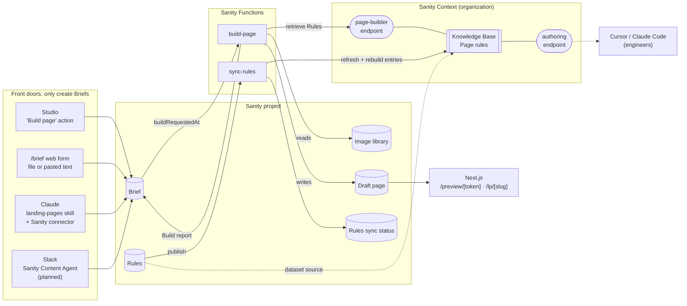
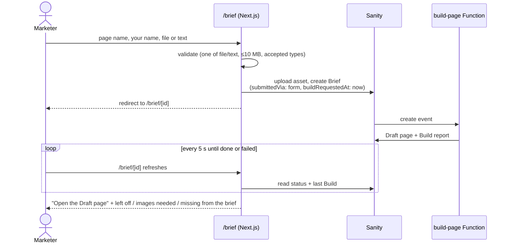
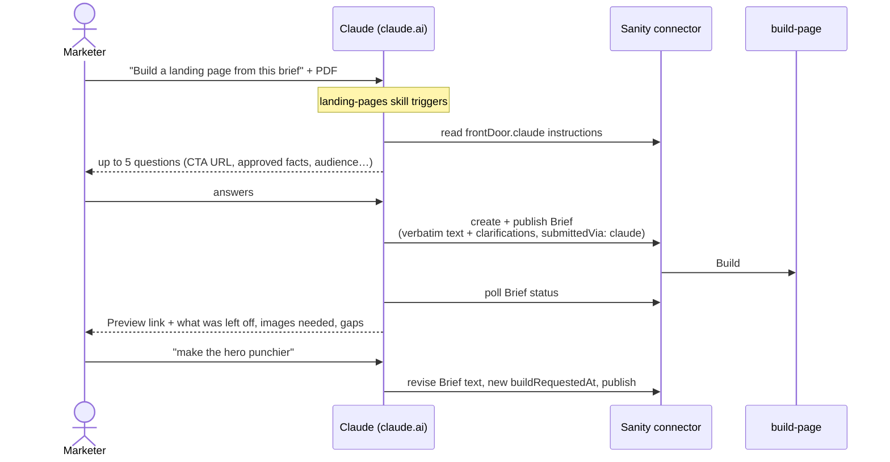
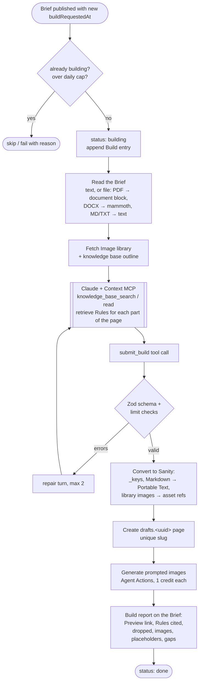
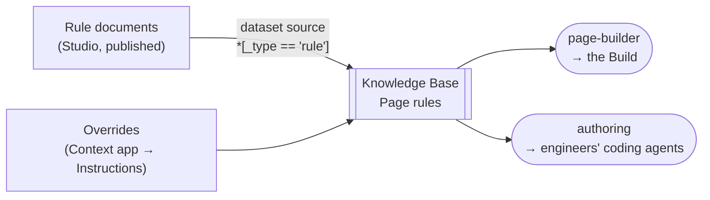
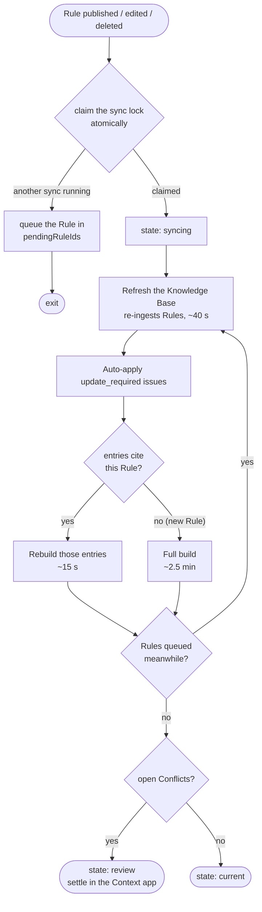
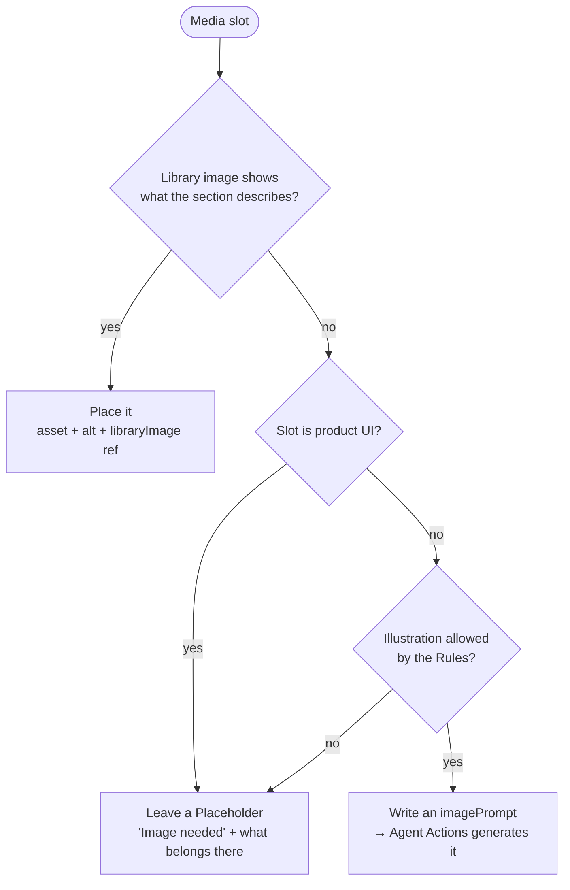
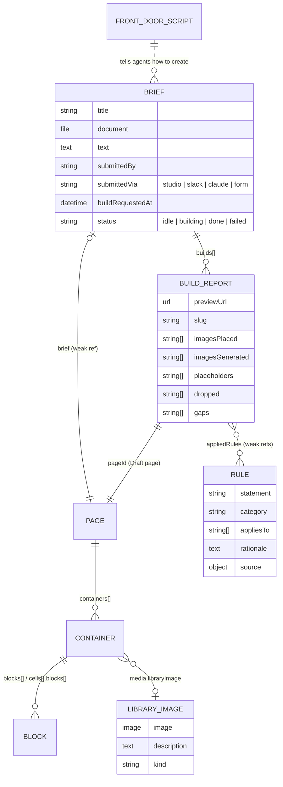

# context-landing-pages

A template for building marketing landing pages from a brief, where every editorial instruction lives in Sanity, not in the repo.

Marketing writes **Rules** in Sanity Studio (voice, copy mechanics, terminology, page composition, images, SEO). A Sanity Context **Knowledge Base** indexes them. When someone submits a **Brief**, from Studio, a web form, Claude, or Slack, a Sanity Function runs a **Build**: Claude retrieves the relevant Rules from the Knowledge Base and writes a **Draft page** that a person reviews and publishes. Edit a Rule, and the next Build follows it within about a minute. No PR, no deploy.

**Built with:** Sanity Studio 6, Sanity Functions and Blueprints, Sanity Context (Knowledge Bases and MCP endpoints), Agent Actions, Next.js 16 with next-sanity 13, and Claude.

### Quick start

1. Create a Sanity project, and have an org admin [enable Context](#0-enable-sanity-context).
2. Copy `studio/.env.example`, `web/.env.example`, and `blueprint/.env.example` to `.env` / `.env.local` and fill in your project and organization ids.
3. Deploy the Studio and seed the starter Rules: [Studio setup](#1-studio).
4. Deploy the Blueprint, set the Function secrets, and connect the Rules to the Knowledge Base: [Blueprint setup](#3-blueprint-functions-and-the-knowledge-base).
5. Run the web app and submit a brief at `/brief`: [Web setup](#2-web).
6. Replace the starter Rules with your own: [Customize](#customize).

---

## Contents

- [How it fits together](#how-it-fits-together)
- [Front doors](#front-doors): Studio, the `/brief` page, Claude, Slack
- [The Build](#the-build)
- [Rules and the Knowledge Base](#rules-and-the-knowledge-base)
- [Images](#images)
- [Content model](#content-model)
- [Repository layout](#repository-layout)
- [Setup](#setup): enable Context, Studio, web, Blueprint, Claude
- [Customize](#customize)
- [Day-to-day operations](#day-to-day-operations)
- [Guardrails and tests](#guardrails-and-tests)
- [Known behaviours and gotchas](#known-behaviours-and-gotchas)

---

## How it fits together



The principle behind it: **front doors never build pages, and the repo never holds editorial judgment.** Every channel creates the same kind of Brief and gets the same pipeline, the same Rules, and the same kind of page. The only prompt in the repo is about ten lines of mechanics, and a test enforces that (see [Guardrails](#guardrails-and-tests)).

---

## Front doors

Every front door does exactly one thing: create (or update) a Brief with `buildRequestedAt` set. The Build takes it from there.

| Front door | Who it's for | How a Brief gets in | Status |
|---|---|---|---|
| **Studio** | Editors | Create a Brief, upload a file or paste text, click **Build page** | ✅ Live |
| **`/brief` web form** | Anyone, no Studio login | Name, your name, file upload (PDF, DOCX, MD, TXT) or textarea | ✅ Live |
| **Claude** | Marketers in claude.ai | Attach or describe a brief; Claude interviews you, then submits | ✅ Live |
| **Slack** | Marketers in Slack | `@Sanity` + the brief, via Sanity's Content Agent | ⏳ Planned |

### Studio

`studio/actions/BuildPageAction.tsx` adds **Build page** to Brief documents. It stamps `buildRequestedAt` and publishes, because the Function only sees published Briefs. While a Build runs, the action is disabled. Each Build appears under the Brief's **Builds** with its Preview link and report.

### The `/brief` page



- `web/src/app/brief/actions.ts` is a server action using `SANITY_API_WRITE_TOKEN` (server-only, `web/src/sanity/write.ts`). It works without JavaScript too: it's a plain multipart POST.
- `web/src/app/brief/[id]/page.tsx` shows the status and the Build report, re-rendering every 5 seconds until the Build finishes.
- The form is open for the demo. The Build Function's daily cap (`BUILD_DAILY_CAP`, default 50) is the circuit breaker on spend. Production should put it behind sign-in.

### Claude

Claude is a front door, not a second page builder: it never writes pages.



Three layers make Claude find its instructions:

1. **The skill**, `claude/skills/landing-pages/SKILL.md`. Replace `YOUR_PROJECT_ID` in it with your project id. It triggers on landing-page requests and contains a single pointer: read `frontDoor.claude` from Sanity and follow it. Zip the folder and upload it in claude.ai under **Settings → Capabilities → Skills**. On Team or Enterprise, an admin can provision it org-wide.
2. **The script**, the `frontDoorScript` document `frontDoor.claude`, editable in Studio under **Front-door scripts**. It holds the actual behaviour: interview, submit, poll, revise, explain.
3. **The schema pointer.** The `brief` type and its `text` field descriptions point at `frontDoor.claude`, so an agent that inspects the schema through a bare Sanity connector, with no skill, still finds it.

Claude reads attached files itself and transcribes them into the Brief's `text`, because the connector can't upload chat attachments. The same goes for screenshots: add them to the **Image library** in Studio before the Build, or the Build leaves Placeholders for them. Changes that should apply to *every* page ("always say…") are redirected to Rules in Studio.

### Slack (planned)

Install the Sanity Slack app, then add one org-level Content Agent custom instruction (Manage → Organization → Settings → Content Agent) pointing at `frontDoor.slack`, the same pattern as Claude. Still to verify: whether Content Agent reads files shared in Slack, and how it handles publish confirmation.

---

## The Build

`blueprint/functions/build-page` runs on Brief create or update when `buildRequestedAt` changes.



| Piece | Where |
|---|---|
| Harness prompt (mechanics only) | `blueprint/functions/build-page/harness.ts` |
| Output contract (Zod mirror of the page builder) | `blueprint/functions/build-page/pageSchema.ts` |
| Conversion to Sanity documents | `blueprint/functions/build-page/toSanity.ts` |
| Reading uploaded briefs | `blueprint/functions/build-page/briefSource.ts` |
| Model | `claude-opus-5-5` (override with `BUILD_MODEL`) |

Every Build makes its **own** Draft page, so a Brief built twice has two pages you can compare side by side. Nothing is ever published by a Build.

**Preview links:** `/preview/[token]` renders one Build's Draft page with no Studio login. The token is 24 random bytes stored on the Build. Editors can also open any Draft page in Studio's **Presentation** tool, which uses draft mode and Visual Editing.

---

## Rules and the Knowledge Base



**A Rule** is one editorial decision: a one-line `statement`, a `category` (voice, copy, terminology, composition, SEO), optional `appliesTo` block types, a `rationale`, do/don't `examples`, and a `source` citing the guide it came from. Rules hold judgment only. Structural facts (allowed blocks, field limits, heading levels) live in the Studio schema's descriptions and validation, and the Build reads them from there.

**The Knowledge Base** (one per org on the current plan) is built by Sanity Context from the published Rules. Context reconciles the Rules into topic entries (`voice`, `cta`, `media`, `seo/url_slugs`…), each citing the Rules it came from by `_id`, and files **Conflicts** when two Rules disagree. You settle a Conflict in the Context app, which creates an **Override**.

**Two endpoints, one Knowledge Base:**

| Endpoint | Read by | Instructions |
|---|---|---|
| `page-builder` | The Build | Overrides take precedence; the Brief is the only source of facts |
| `authoring` | Cursor / Claude Code | Rules are authoritative for copy, blocks, terminology, images, and SEO; structure comes from the schema; never restate Rules in code or docs |

Both are declared in `blueprint/sanity.blueprint.ts`, with instructions in `blueprint/lib/instructions.ts`. Their names come from `MCP_ENDPOINT` and `AUTHORING_ENDPOINT` in `blueprint/.env`.

Connect a coding agent with an **org-level** token that has Context Viewer (project tokens are refused):

```sh
claude mcp add --transport http authoring \
  https://api.sanity.io/v1/context/organizations/YOUR_ORG_ID/mcp/authoring \
  --header "Authorization: Bearer $SANITY_CONTEXT_TOKEN"
```

```json
// .cursor/mcp.json
{
  "mcpServers": {
    "authoring": {
      "url": "https://api.sanity.io/v1/context/organizations/YOUR_ORG_ID/mcp/authoring",
      "headers": { "Authorization": "Bearer ${env:SANITY_CONTEXT_TOKEN}" }
    }
  }
}
```

### Rules sync

Publishing, editing, or deleting a Rule runs `blueprint/functions/sync-rules`:



The **Rules sync status** singleton in Studio shows `syncing`, `current`, `review` or `failed`, the last sync time, and open Conflicts, so you know when an edit has landed. Each Build records the sync it used.

| Operation | Typical time |
|---|---|
| Edit a Rule → Knowledge Base current | ~1 minute |
| Add a brand-new Rule (full build) | ~2.5 minutes |
| Brief → Draft page | ~1–2 minutes |
| First Knowledge Base build (about 80 Rules) | ~3.5 minutes |

---

## Images

Each media slot (Media With Section, Content Grid image, Callout image) is filled according to the Rules, with the **Image library** as data:



- **Image library** (`libraryImage`): an image with alt text, a description, a `kind` (`product-ui`, `illustration`, `photo`), and product tags. Add images in Studio under **Image library**; the next Build considers them.
- **Generation** happens after the page is written: one Agent Actions `generate` call per prompted slot, targeting that slot's `asset` on the Draft page. Each call costs 1 AI credit, and the image arrives a few seconds later; the page shows "Generating image…" until it does.
- **Provenance:** every image records the `libraryImage` it came from or the `imagePrompt` that generated it.
- The policy itself (library first, never generate product UI, abstract illustrations only, alt text describes the image) is a set of Rules, editable in Studio.

---

## Content model



**The page builder:**

```
pageBuilderPage
├─ hero                 pageBuilderHero (eyebrow, heading, subheading, ≤2 CTAs), the page's only h1
├─ containers[]
│   ├─ pageBuilderSectionHeader      demotes the headings that follow
│   ├─ pageBuilderMediaWithSection   media + blocks, alternating sides
│   ├─ pageBuilderContentGrid        cells[] of blocks
│   └─ pageBuilderSpeedBump          1–4 blocks, closing CTA
└─ faq                  pageBuilderFaq, rendered last

blocks: Eyebrow · Heading (+ italic matchedText) · Subheading · Text · Checklist ·
        Feature List · CTA · Quote · Callout · Image
```

---

## Repository layout

```
.
├─ web/                       Next.js 16 (App Router, Cache Components), deployed to Vercel
│  └─ src/
│     ├─ app/lp/[slug]/       published landing pages
│     ├─ app/preview/[token]/ one Build's Draft page, no login
│     ├─ app/brief/           the web-form front door + status page
│     ├─ app/api/draft-mode/  Presentation / Visual Editing
│     ├─ components/page-builder/
│     └─ sanity/              client, live fetch, queries, server-only write client
├─ studio/                    Sanity Studio 6
│  ├─ schemaTypes/            page builder, brief, rule, libraryImage, frontDoorScript, rulesSyncStatus
│  ├─ actions/                "Build page" document action
│  ├─ structure.ts            desk: Briefs, Landing pages, Image library, Rules by category…
│  └─ scripts/seed.ts         seeds Rules, Image library, front-door scripts, example Briefs
├─ blueprint/                 Sanity Blueprint (org-scoped stack), with no sanity.cli.ts on purpose
│  ├─ sanity.blueprint.ts     Knowledge Base, 2 Context endpoints, 2 Functions
│  ├─ functions/build-page/   the Build
│  ├─ functions/sync-rules/   Rules sync
│  ├─ lib/                    config, Context client helpers, endpoint instructions
│  ├─ scripts/connect-rules.mjs   one-time: attach Rules to the Knowledge Base and build it
│  └─ tests/                  vocabulary guard, schema-drift guard, converter tests
├─ claude/skills/landing-pages/   the Claude Skill (pointer to frontDoor.claude)
├─ examples/seed/             starter Rules, front-door scripts, and an example brief
└─ .agents/skills/            Sanity best-practice skills for coding agents
```

Each app keeps its own `package.json` and `pnpm-lock.yaml`; run commands from inside the app folder.

---

## Setup

### 0. Enable Sanity Context

An organization admin turns on Context and Knowledge Bases (both opt-in betas) from the organization's **Labs** page: `https://www.sanity.io/organizations/YOUR_ORG_ID/labs`

Until they're on, the Blueprint can't create the Knowledge Base or its endpoints.

### 1. Studio

Copy `studio/.env.example` to `studio/.env` and set `SANITY_STUDIO_PROJECT_ID` (and `SANITY_STUDIO_PREVIEW_URL` once the web app is deployed). Then:

```sh
cd studio
pnpm install
pnpm typegen        # writes studio/schema.json and web/sanity.types.d.ts
pnpm run deploy     # deploys the Studio and both schemas
```

Set `SANITY_STUDIO_HOST` to the `*.sanity.studio` hostname you want before the first deploy. Afterwards, put the printed app id in `SANITY_STUDIO_APP_ID` so later deploys update the same Studio.

Always deploy schema changes with `pnpm run deploy`. Sanity keeps two schemas: the Studio's own, read by the Sanity MCP connector (and therefore by Claude), and `_.schemas.default`, used by Agent Actions for image generation. A Studio deploy updates both; `sanity schema deploy` updates only the second.

Seed the starter content: Rules, front-door scripts, and an example brief.

```sh
SANITY_STUDIO_URL=https://your-studio.sanity.studio \
  npx sanity exec scripts/seed.ts --with-user-token -- ../examples/seed
```

The seed writes only Rules that changed, because every published Rule write starts a Rules sync. Run it before the Blueprint's first deploy, so the Knowledge Base has Rules to connect to.

### 2. Web

Copy `web/.env.example` to `web/.env.local` (and set the same variables in Vercel):

| Variable | Scope | Purpose |
|---|---|---|
| `NEXT_PUBLIC_SANITY_PROJECT_ID` | public | Your project id |
| `NEXT_PUBLIC_SANITY_DATASET` | public | `production` |
| `NEXT_PUBLIC_SANITY_STUDIO_URL` | public | Your deployed Studio, for click-to-edit overlays |
| `SANITY_API_READ_TOKEN` | server | Viewer: draft mode, Preview links, status page |
| `SANITY_API_WRITE_TOKEN` | server | Editor: the `/brief` form creates Briefs |

```sh
cd web && pnpm install && pnpm dev
```

Deploy to Vercel either way:

```sh
# Simplest: link and deploy from inside web/ (no Root Directory setting needed)
cd web && vercel link && vercel deploy --prod

# Or: set the Vercel project's Root Directory to `web` and deploy from the repo root
vercel deploy --prod
```

`NEXT_PUBLIC_*` variables must be added with `--visibility config --no-sensitive` on Production and Preview; the tokens can stay sensitive. After the first deploy, set `PREVIEW_BASE_URL` (Blueprint) and `SANITY_STUDIO_PREVIEW_URL` (Studio) to the production URL, add it as a CORS origin with credentials, and redeploy both.

### 3. Blueprint, Functions, and the Knowledge Base

Copy `blueprint/.env.example` to `blueprint/.env` and fill in your project, dataset, organization, and web URL. Then, from `blueprint/`, signed in with a personal login (deploy tokens can't attach dataset sources):

```sh
pnpm install
pnpm dlx sanity@latest blueprints init . --blueprint-type ts --organization-id YOUR_ORG_ID --stack-name production
pnpm run deploy                 # Knowledge Base, endpoints, Functions
pnpm run connect-rules          # attach published Rules to the Knowledge Base, first build
```

Function secrets (never put them in the Blueprint):

| Function | Secret | Value |
|---|---|---|
| `build-page` | `ANTHROPIC_API_KEY` | Anthropic API key |
| `build-page` | `SANITY_CONTEXT_TOKEN` | org token, **Context Viewer** |
| `build-page` | `SLACK_WEBHOOK_URL` *(optional)* | posts "Build ready" to a channel |
| `build-page` | `BUILD_DAILY_CAP` *(optional)* | default 50 |
| `sync-rules` | `SANITY_CONTEXT_TOKEN` | org token, **Context Editor** (it applies issues) |
| `sync-rules` | `KNOWLEDGE_BASE_ID` | skips the lookup |

```sh
pnpm dlx sanity@latest functions env add build-page ANTHROPIC_API_KEY <key>
```

### 4. Claude

Set your project id in `claude/skills/landing-pages/SKILL.md`, zip the folder, and upload it in claude.ai (Settings → Capabilities → Skills). Users also need the **Sanity** connector enabled, signed in with their own Sanity account.

---

## Customize

| To change | Edit |
|---|---|
| How pages are written | Rules in Studio. `examples/seed/rules.json` is only a starting point; replace it with your own guide, one decision per Rule |
| The page builder (containers, blocks, fields) | `studio/schemaTypes/objects/pageBuilder/`, the matching renderer in `web/src/components/page-builder/`, and the Build's output contract in `blueprint/functions/build-page/pageSchema.ts`. `pnpm test` in `blueprint/` fails until the contract matches the schema |
| How Claude and Slack act as front doors | The front-door scripts in Studio, seeded from `examples/seed/front-door-*.md` |
| Approved images | Studio → **Image library**, or `library.json` in your seed folder (`url` or `file`, plus `description` and `kind`) |
| Look and feel | `web/src/components/page-builder/` and `web/src/app/globals.css` (Tailwind) |
| Knowledge Base and endpoint names | `blueprint/.env`, before the first deploy |
| Build model or daily cap | `BUILD_MODEL` in `blueprint/.env`; `BUILD_DAILY_CAP` as a Function env var |

Keep editorial wording out of the code. If an instruction is about how copy should read or which block to use, it belongs in a Rule; the vocabulary test in `blueprint/tests/harness.test.ts` enforces this for the prompt and endpoint instructions.

---

## Day-to-day operations

| I want to… | Do this |
|---|---|
| Change how pages are written | Edit or add a Rule in Studio and publish. Watch **Rules sync status** go `current` |
| Settle two Rules that disagree | Context app → the Knowledge Base → Issues → resolve (creates an Override) |
| Build a page | Any front door; or in Studio, open a Brief → **Build page** |
| Rebuild the same Brief | **Build page** again; each Build is a new Draft page |
| Add an image Builds can use | Studio → **Image library** → new entry with a description and kind |
| Change how Claude behaves as a front door | Edit **Front-door scripts → Claude (Sanity connector)** in Studio |
| Watch a Function | `cd blueprint && pnpm run logs` |
| Inspect the Knowledge Base | `npx sanity@latest context entries list <kb-id>` (run outside `studio/`) |

---

## Guardrails and tests

```sh
cd blueprint && pnpm test
```

| Test | Fails when |
|---|---|
| `tests/harness.test.ts` | Editorial vocabulary ("voice", "tone", "compelling", "jargon"…) appears in the harness prompt, the output-contract descriptions, or either Context endpoint's instructions. That kind of instruction belongs in a Rule. |
| `tests/pageSchema.test.ts` | The Build's Zod output contract emits a type or field that doesn't exist in `studio/schema.json`, or misses a Studio container |
| `tests/toSanity.test.ts` | The Markdown → Portable Text conversion or the schema limit checks regress |

Other guardrails:

- **Drafts only.** A Build never publishes; a person always does.
- **Facts only from the Brief.** This is enforced by Rules and the endpoint instructions, and the Build report lists anything it left out.
- **Product UI is never generated.** This is a Rule; product slots without a library image stay Placeholders.
- **Daily Build cap** on the Function, the circuit breaker for the open form.
- **Preview links** are unguessable per-Build tokens, and their pages are `noindex`.

---

## Known behaviours and gotchas

- **Context needs organization tokens.** Project tokens get `403 contextGrantRequired`. The Build sends its Viewer token to Anthropic so Claude can read the Knowledge Base; it's read-only and scoped to Context.
- **claude.ai can't connect to Context endpoints.** They accept only a static bearer token, not OAuth. That's why marketers go through the Sanity connector and the front-door script, and only engineers' local agents use the `authoring` endpoint.
- **A Knowledge Base has two ids.** `id` is a UUID used by the CLI and management API; `publicId` (`kb…`) is what entry documents carry in `knowledgeBaseId` and what the MCP search tools expect.
- **A refresh doesn't rewrite entries for an edited Rule.** It re-ingests the Rules but files no issue for the change, so `sync-rules` also rebuilds the entries that cite the Rule.
- **A full build can reorganize the outline** (entry paths change). Nothing here hard-codes entry paths.
- **Scheduled Knowledge Base refresh is plan-gated.** On plans without it, `connect-rules` warns and moves on; `sync-rules` still refreshes on every Rule publish.
- **`delta::changedAny` is false on create.** The Build trigger also accepts `delta::operation() == "create"`, because the form, Claude, and Slack create Briefs with `buildRequestedAt` already set.
- **One endpoint, one retrieval mode.** Adding a dataset source to a Knowledge Base endpoint silently switches it to GROQ mode and ignores the Knowledge Base.
- **Run `sanity context …` outside `studio/`.** A directory with a `sanity.cli.ts` breaks those commands; `blueprint/` has none on purpose.
- **Never name a Blueprint env var `SANITY_PROJECT_ID`.** The Blueprints CLI reads it as a scope override.
- **Vercel:** deploy from `web/`, or set the Root Directory to `web` and deploy from the repo root; mixing the two fails with "Root Directory does not exist". Team-scoped `*.vercel.app` aliases can sit behind Vercel Authentication; point `PREVIEW_BASE_URL` at the public production domain.
- **Beta surface.** Knowledge Bases, Context Blueprint resources, and Agent Actions (image generation) are beta or experimental. Pin versions and re-check the Sanity docs before upgrading.
